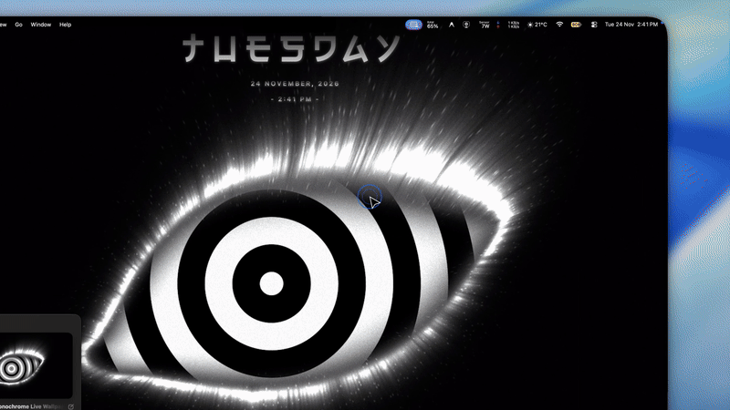

<div align="center">

# Wallwright

**A native macOS live wallpaper engine.**
Video wallpapers on your desktop, lock screen, and screensaver, all in sync, all at once.

[](LICENSE)
[](#build--run)
[](https://github.com/anonyks/wallwright/actions/workflows/ci.yml)
[](https://github.com/anonyks/wallwright/releases/latest)
[](https://github.com/anonyks/wallwright/stargazers)



*[Watch the full demo](docs/assets/wallwright-showcase.mp4)*

</div>

---

Wallwright turns any video into a live wallpaper everywhere macOS shows one, not just the
desktop: a real native `com.apple.wallpaper` extension keeps it decoding and playing behind the
lock screen and screensaver too, not a frozen poster frame standing in for it. It ships with a
full library manager, playlist rotation, Steam Workshop import, a drag-anywhere clock overlay, a
Spotlight-style command palette, and built-in browsers for several free wallpaper sites, so you
never have to leave the app to find something new.

Written for people who wanted [Wallpaper Engine](https://www.wallpaperengine.io) on Steam
but run macOS.

## Why Wallwright

Most open-source live-wallpaper projects for macOS are built once and left alone. Wallwright's
been through repeated, adversarial rounds of live-testing and bug fixing (decode races,
crash-recovery, per-display stability across reboots), the kind of engineering that a demo
doesn't show but a week of actual daily use exposes:

- **Survives reboots and monitor swaps.** Wallpaper assignments key off a stable per-display
  UUID, not the raw display ID macOS hands out fresh every boot, so your monitor setup doesn't
  get scrambled after a restart or a dock/undock.
- **Recovers from playback failures instead of freezing.** A corrupt file, a dropped external
  drive, an unplayable codec: Wallwright detects it and retries once, rather than leaving your
  desktop silently frozen on the last good frame with no explanation.
- **Actually pauses when it should.** Thermal throttling, low battery, another app in
  fullscreen, the display asleep: each is its own configurable trigger, checked live, not
  polled on a timer burning battery to ask "should I still be running?"
- **No wasted decode.** Video and audio are decoded once each, not twice, a bug present in
  most forks of this codebase that went unnoticed until it was profiled and fixed here.

None of that is visible in a screenshot. It's why the desktop stays correct at 3am on day 40,
not just in the demo.

## Features

- Video wallpapers playing live on desktop, lock screen, and screensaver at once
- Multi-display support with a per-screen wallpaper picker
- Playlist rotation, pinning (right-click, or float pinned wallpapers to the top), and a
  recent-wallpapers menu
- Drag-repositionable clock overlay with custom formats and gradients. Each wallpaper keeps its
  own clock setup, and the Custom color follows the wallpaper until you override it
- Auto-pause on thermal pressure, low battery, fullscreen apps, or the display asleep, each its
  own configurable trigger
- Spotlight-style command palette for every action, plus [scripting](#scripting) through a
  named pipe
- Menu bar controls for playback, volume, and system usage
- Trim and crop editing, including auto-detection of black bars baked into a video
- Tag, audio, media-type and color filtering in the library grid
- Video Fit (Fill, Fit or Stretch) for all wallpapers, or one at a time

## Scripting

While Wallwright is running, write a command to its named pipe:

```sh
echo "next" > /tmp/wallwright-$(id -u).pipe
```

| Command | Does |
|---|---|
| `pause`, `resume`, `toggle` | Control playback |
| `mute`, `unmute`, `togglemute`, `volume 0-100` | Control sound |
| `next`, `prev` | Move through the playlist |
| `apply <title>` | Apply the first library wallpaper whose title contains the text |
| `import <path>` | Add a local video or image to the library |
| `pin` | Pin or unpin the current wallpaper |
| `status` | Write the current state to `/tmp/wallwright-$(id -u)-status.json` |
| `palette` | Write the current wallpaper's colors to `/tmp/wallwright-$(id -u)-palette.json` |
| `toggleclock` | Show or hide the clock |
| `clockalignment left\|center\|right` | Set the clock's text alignment |
| `clearcache` | Clear the thumbnail cache |
| `quit` | Quit Wallwright |

Writing to the pipe waits until something reads it, so check that the app is running first
(`pgrep -x Wallwright`).

To react to wallpaper changes, put an executable script at `~/.config/wallwright/on_change.sh`.
It receives `--file <path>`, then `--dominant-hex <#RRGGBB>`, `--accent-hex <#RRGGBB>` and
`--is-dark <true|false>` (left out if the preview can't be read), and is stopped if it runs for
more than 5 seconds. The same colors are also written to
`~/.config/wallwright/palettes/current.json`.

## Import

- Folder, `.zip`, or a bare video file, via File > Import or drag-and-drop
- Any site yt-dlp supports, by URL, not just YouTube
- Steam Workshop, by item URL/ID or full keyword search with Genre/category filters, Safe Mode
  on by default
- Inbox: share a link from your phone over ntfy.sh, it shows up in-app ready to import
- Manually, by placing wallpaper folders in `~/Library/Application Support/Wallwright/`

## Browse & Download

Built-in browsers for free wallpaper sites, with search and one-click download.

- **Video**: [MotionBgs](https://motionbgs.com), [MoeWalls](https://moewalls.com), [Wallper.app](https://www.wallper.app), [DesktopHut](https://www.desktophut.com)
- **Image**: [UHDPaper](https://www.uhdpaper.com), [AlphaCoders](https://alphacoders.com)

Wallwright is not affiliated with any of these sites. Media remains subject to each site's own terms.

## Supported Types

Video and static images, including HEIC dynamic desktop wallpapers (the time-of-day-shifting
kind macOS ships by default). Steam Workshop Scene wallpapers are imported too: Wallwright
doesn't render live scenes, so it extracts the real background art from the package and sets
it as a static image instead.

## Install

Grab the latest signed build from **[Releases](https://github.com/anonyks/wallwright/releases/latest)**:
download, drag to Applications, done. No Xcode required.

Release builds are not notarized by Apple, so Gatekeeper will warn on first launch. Right-click
the app and choose Open, or run `xattr -d com.apple.quarantine /Applications/Wallwright.app`,
to get past it.

Prefer to build it yourself, or want to modify it? See [Build & Run](#build--run) below.

## External Tools

Optional, used only by the feature that needs them. Wallwright looks for each one at the
standard Homebrew locations (`/opt/homebrew/bin`, `/usr/local/bin`) and `/usr/bin`, falling back
to `which`, so a plain `brew install` is enough, no PATH setup needed.

| Tool | Used for | Install |
|---|---|---|
| [yt-dlp](https://github.com/yt-dlp/yt-dlp) | Video import from URL and the Inbox | `brew install yt-dlp` |
| [ffmpeg](https://ffmpeg.org) | Transcoding unsupported formats, crop detection | `brew install ffmpeg` |
| [steamcmd](https://developer.valvesoftware.com/wiki/SteamCMD) | Steam Workshop import | `brew install steamcmd` |

## Build & Run

```sh
git clone https://github.com/anonyks/wallwright.git
cd wallwright
open "Wallwright.xcodeproj"
```

Requires macOS 26+ and Xcode 26+. Select "Sign to Run Locally", then `Cmd + R`.

## Contributing

Issues and pull requests are welcome. See [open issues](https://github.com/anonyks/wallwright/issues)
for known gaps. This is a personal project maintained in spare time, so response time varies.

## Author

Wallwright is written and maintained by [anonyks](https://github.com/anonyks), with development
assistance from Claude Code (Anthropic).

## Attribution

Wallwright is a fork, and a few specific mechanisms were adapted from other open-source work
rather than written from scratch. Credited here for that reason, not as active collaborators on
this project:

- Original architecture, scene rendering, localization, icons, and other pieces this project was
  forked from: see [Unayung/wallpaper-engine-mac](https://github.com/Unayung/wallpaper-engine-mac)
  for the original authors and contributors
- **[Raunak Gupta](https://github.com/Raunik2)**: lock-screen sync, Aerial registration, and the command-pipe listener are adapted from [LivePaper](https://github.com/Raunik2/LivePaper) (MIT)
- **[kageroumado](https://github.com/kageroumado)**: the low-power-conditions auto-pause policy is modeled on [Phosphene](https://github.com/kageroumado/phosphene)'s PowerMonitor (MIT)

Steam and Wallpaper Engine are registered trademarks of Valve Corporation. YouTube is a trademark
of Google LLC. Wallwright is an independent open-source project and is not affiliated with,
endorsed by, or sponsored by Valve Corporation, Google LLC, or Apple Inc.

## License

[GPL-3.0](LICENSE), same as the original project.
